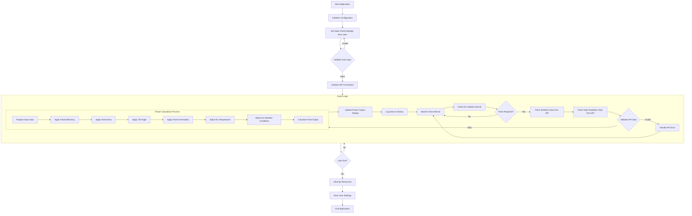

# Solar Panel Power Output Simulation

## Conceptual Model  
This simulation estimates solar panel power output under varying weather conditions. It predicts how factors such as temperature, cloud cover, wind speed, and solar irradiance impact solar energy generation.  

## Objective  
The purpose of this simulation is to:  
- Estimate the power output of solar panels under diverse weather conditions.  
- Provide a tool for understanding the relationship between weather patterns and solar energy production.  

### Target Audience  
- **Solar energy producers**: Businesses and utility companies.  
- **Homeowners**: Individuals with solar panel installations.  
- **Researchers**: Experts in renewable energy.  

### Purpose of Results  
- Offer insights into solar energy generation efficiency based on weather conditions.  
- Assist in making informed decisions about solar panel investments and system design.  
- Model expected power output for optimized installation planning.  

## Inputs (Feeds)  
The simulation requires the following inputs:  

### Weather Data  
- **Location**: Geographic coordinates (latitude and longitude).  
- **Temperature**: Measured in °C.  
- **Cloud Cover**: Percentage of cloud coverage.  
- **Wind Speed**: Measured in m/s.  
- **Solar Irradiance**: Measured in W/m².  

### Solar Panel Specifications  
- **Panel Type**: Monocrystalline, polycrystalline, etc.  
- **Orientation**: Angle and direction of the panels.  
- **System Size**: Number of panels and total area.  

### Simulation Timeframe  
- Start and end dates for the simulation period.  

## Outputs (Printouts)  
The simulation provides the following performance metrics:  

### Key Metrics  
- **Estimated Power Output**: Total power generated (kW or MW).  
- **Efficiency Metrics**: Percentage of solar energy converted into electrical power.  
- **Weather Impact**: Breakdown of how weather variables affect power output.  
- **Comparison Metrics**: Forecasted vs. actual power output (if historical data is available).  

### Data Presentation  
- Hourly, daily, and monthly power generation data.  
- Utilization rates: Efficiency of the solar panel system under specific conditions.  
- Throughput: Total energy generated over a given period.  
- **Optional**: Queue lengths for modeling multiple systems or regions.


## Program flow


## Running the Project
To run the simulation, follow these steps:

### MacOS
1. Open the terminal.
2. Go to the "demo" directory.
3. Run the command:
   ```bash
   mvn javafx:run
   ```

### Windows
1. Open the command prompt.
2. Go to the "demo" directory.
3. Run the command:
   ```bash
   mvn javafx:run
   ```

## Conclusion  
This simulation serves as a valuable tool for solar energy stakeholders, enabling better decision-making and optimized solar panel installations by analyzing the impact of weather conditions on energy production.  